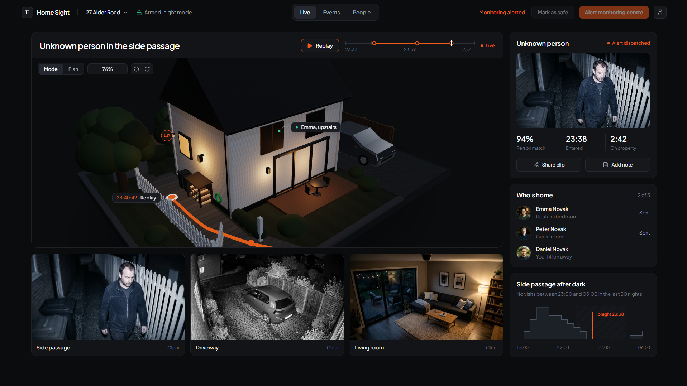
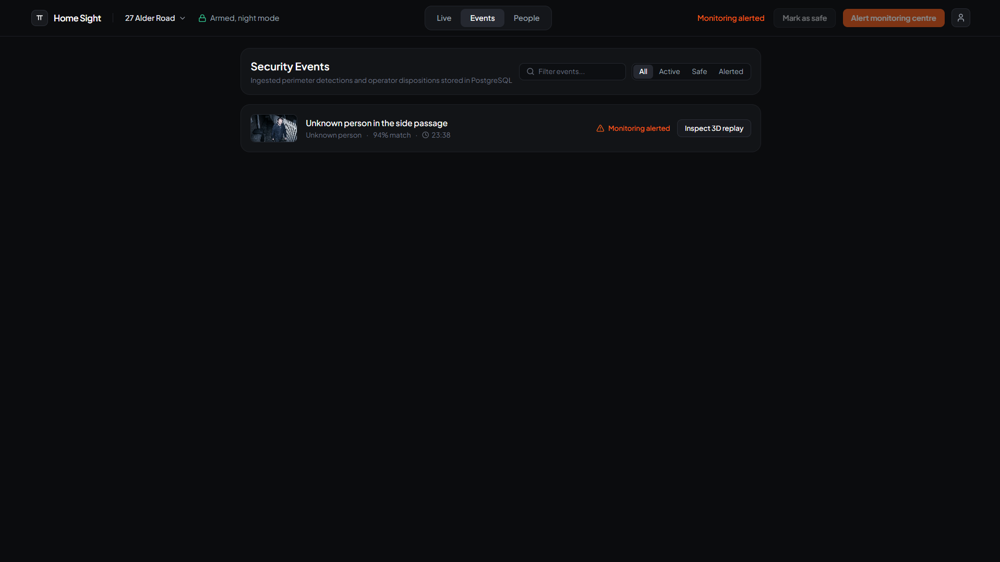
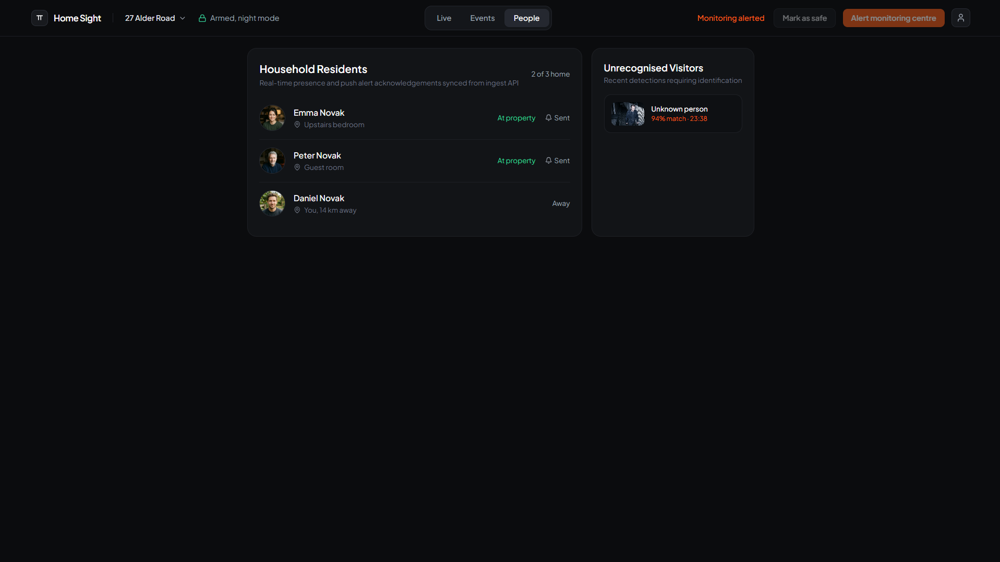
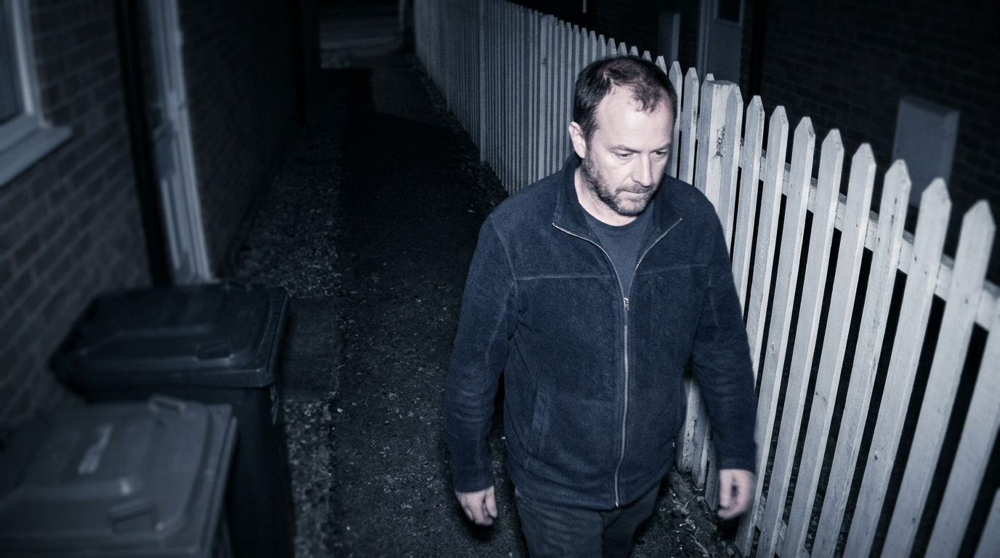
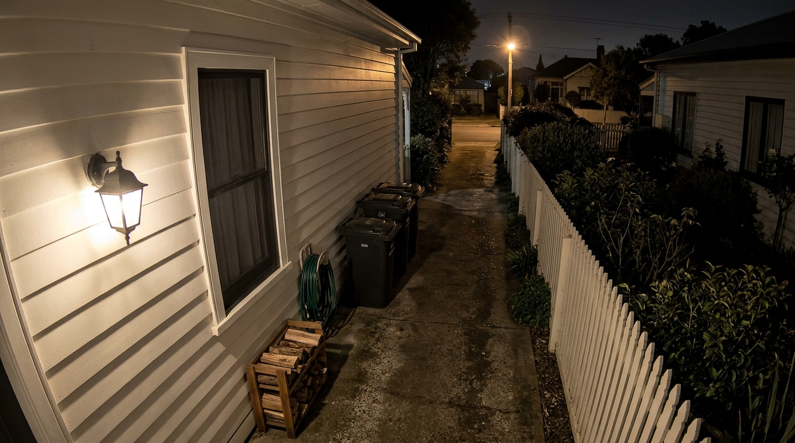
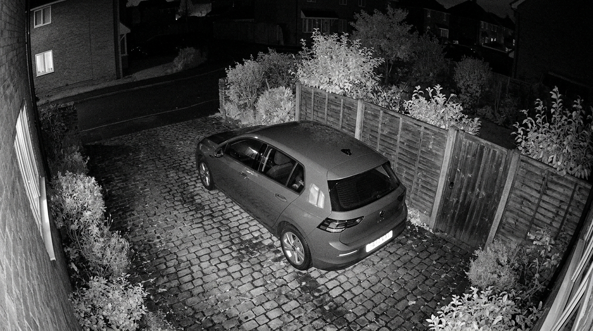
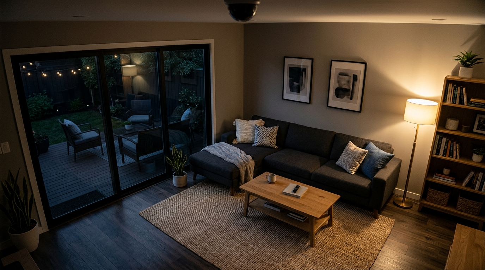
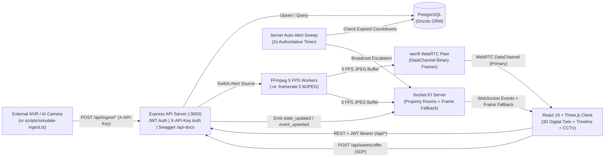

<div align="center">

# Home Sight

**Real-time 3D spatial residential security & perimeter intelligence platform.**

Interactive nocturnal 3D digital twin, 5 FPS FFmpeg WebRTC/Socket.IO CCTV streaming, external `X-API-Key` event ingestion, and PostgreSQL + Drizzle ORM persistence.

[](https://www.typescriptlang.org/)
[](https://react.dev/)
[](https://threejs.org/)
[](https://expressjs.com/)
[](https://www.postgresql.org/)
[](https://orm.drizzle.team/)
[](https://socket.io/)
[](https://webrtc.org/)
[](https://ffmpeg.org/)
[](https://swagger.io/)

</div>

---

## Interface & Visual Preview

<p align="center">
  
</p>

<table width="100%">
  <tr>
    <td width="33.33%" align="center" valign="top">
      
      <br />
      <sub><strong>Events Triage</strong> — Ingested perimeter detections &amp; alert states</sub>
    </td>
    <td width="33.33%" align="center" valign="top">
      
      <br />
      <sub><strong>People &amp; Presence</strong> — Residents status &amp; unrecognised visitors</sub>
    </td>
    <td width="33.33%" align="center" valign="top">
      
      <br />
      <sub><strong>Side Passage (Alert)</strong> — Active intruder detection feed</sub>
    </td>
  </tr>
  <tr>
    <td width="33.33%" align="center" valign="top">
      
      <br />
      <sub><strong>Side Passage (Clear)</strong> — 5 FPS nocturnal perimeter stream</sub>
    </td>
    <td width="33.33%" align="center" valign="top">
      
      <br />
      <sub><strong>Driveway (IR)</strong> — Monochrome infrared night feed</sub>
    </td>
    <td width="33.33%" align="center" valign="top">
      
      <br />
      <sub><strong>Living Room</strong> — Interior wide-angle camera stream</sub>
    </td>
  </tr>
</table>

---

## Project Structure

```text
home-sight/
├── docs/                              # Repository documentation media assets
│   ├── screen_home_sight_main.png
│   ├── screen_home_sight_events.png
│   ├── screen_home_sight_people.png
│   ├── cam_side_person.jpg
│   ├── cam_side_passage.jpg
│   ├── cam_driveway_ir.jpg
│   └── cam_living_room.jpg
├── scripts/                           # Standalone CLI utilities & simulators
│   ├── ffmpeg-webrtc-stream.ts        # Standalone FFmpeg WebRTC stream verification helper
│   └── simulate-ingest.ts             # External system simulator targeting /api/ingest/*
├── src/
│   ├── assets/images/                 # Source CCTV frames & resident avatars
│   ├── components/
│   │   ├── ApiKeysModal.tsx           # Operator modal for managing X-API-Key ingest tokens
│   │   ├── AuthScreen.tsx             # JWT login & first-admin bootstrap registration
│   │   ├── CameraFeedRow.tsx          # Bottom 3-camera 5 FPS live feed strip with bounding boxes
│   │   ├── EventsView.tsx             # Security events filter & 3D replay trigger
│   │   ├── HouseScene3D.tsx           # Three.js nocturnal 3D digital twin, Model/Plan & trajectory
│   │   ├── PeopleView.tsx             # Resident presence & unrecognised visitor panel
│   │   ├── RightSidebar.tsx           # Unknown person snapshot, Who's home, After-dark histogram
│   │   ├── TopBar.tsx                 # Property switcher, mode pill, Live/Events/People, auto-alert CTA
│   │   └── ViewportTimeline.tsx       # Interactive replay scrubber & keyframe markers
│   ├── db/
│   │   ├── index.ts                   # PostgreSQL pg Pool + Drizzle ORM initialization (discrete env)
│   │   └── schema.ts                  # Normalized Drizzle tables (users, properties, events, telemetry)
│   ├── hooks/
│   │   ├── useCctvStream.ts           # WebRTC DataChannel consumer with Socket.IO 5 FPS fallback
│   │   └── useSocket.ts               # Authenticated Socket.IO real-time client hook
│   ├── server/
│   │   ├── auth.ts                    # User JWT signing/verification + SHA-256 API Key middleware
│   │   ├── routes.ts                  # App API, WebRTC SDP signaling, and External Ingest endpoints
│   │   ├── socket.ts                  # Socket.IO property rooms & live camera frame broadcaster
│   │   ├── stream-manager.ts          # FFmpeg 5 FPS static-image worker & werift RTCPeerConnection
│   │   └── swagger.ts                 # OpenAPI 3.0 specification served at /api-docs
│   ├── types/
│   │   └── homesight.ts               # Shared TypeScript domain contracts
│   ├── App.tsx                        # Main workspace state, replay loop & real-time sync
│   ├── index.css                      # Tailwind CSS v4 theme & design tokens
│   └── main.tsx                       # React 19 entry point
├── drizzle.config.ts                  # Drizzle Kit schema & discrete PostgreSQL config
├── metadata.json                      # Application manifest metadata
├── package.json                       # Build, runtime, DB push & simulator scripts
├── server.ts                          # Unified Express + Socket.IO + Vite/dist entry point
└── vite.config.ts                     # Vite build config + asset copy plugin
```

---

## App System Architecture

Home Sight strictly separates **External Telemetry Ingestion** (`X-API-Key`), **Operator Dashboard Access** (User JWT), **Real-Time Media Pipelines** (FFmpeg 5 FPS → WebRTC DataChannel / Socket.IO), and **PostgreSQL Persistence** (Drizzle ORM). No dummy data is generated inside the browser or backend routes—all property topology and detection events enter exclusively through the documented Ingest API.



### Key Architectural Guarantees

1. **Dual Authentication Boundary**
   - **Dashboard Users (`/api/auth/*`, `/api/properties/*`, `/api/events/*`, `/api/api-keys/*`, `/api/webrtc/offer`)**: Authenticated via `Authorization: Bearer <JWT>` issued on login/register (`bcryptjs` hashed credentials). First registered account automatically receives `admin` role.
   - **External Systems (`/api/ingest/*`)**: Authenticated exclusively via `X-API-Key` header, validated against SHA-256 hashed keys stored in `api_keys` or the environment `INGEST_API_KEY`.
2. **Real-Time Sync & Server-Authoritative Timers**
   - Every mutation (ingest event, trajectory append, resident presence update, camera status change, or operator `Mark as safe` / `Alert monitoring centre`) persists to PostgreSQL first and immediately broadcasts to the property's Socket.IO room (`property:<id>`).
   - Auto-alert countdowns are evaluated server-side every 2 seconds (`runAutoAlertSweep`) so client reloads never reset or desynchronize alert escalation.
3. **5 FPS FFmpeg Static-Image WebRTC Pipeline**
   - `FfmpegWebRtcStreamManager` spawns per-camera FFmpeg workers (`-re -loop 1 -framerate 5`) producing live MJPEG frames with subtle nocturnal sensor modulation.
   - Frames stream to the browser over `werift` WebRTC DataChannels (`POST /api/webrtc/offer`) with automatic seamless fallback to Socket.IO binary frames (`camera:frame`) when UDP/ICE is restricted behind proxies.
4. **Interactive OpenAPI Documentation**
   - Full interactive Swagger UI is hosted at `/api-docs` with raw OpenAPI JSON at `/api-docs/swagger.json`.

---

## Tech Stack

| Layer | Technology | Purpose |
| :--- | :--- | :--- |
| **Frontend UI** | React 19, TypeScript, Tailwind CSS v4, Lucide React, Motion | Responsive dark security console & operator workflows |
| **3D Spatial Twin** | Three.js (`0.187`) | Nocturnal residential 3D diorama, Model/Plan projection, animated replay trajectory & camera markers |
| **Media & Realtime** | FFmpeg, `werift` (WebRTC), Socket.IO (`4.8`) | 5 FPS CCTV streaming over WebRTC DataChannel & instant WebSocket state synchronization |
| **Backend & Docs** | Node.js, Express (`4.21`), Zod, Swagger UI Express | Unified HTTP/WS server, strict schema validation & `/api-docs` |
| **Database & ORM** | PostgreSQL (`pg`), Drizzle ORM (`0.45`), Drizzle Kit | Relational persistence with discrete connection parameters (`DB_HOST`, `DB_PORT`, `DB_NAME`, `DB_USER`, `DB_PASSWORD`, `DB_SSL`) |
| **Security** | `jsonwebtoken`, `bcryptjs`, SHA-256 API Keys | Separated user session JWTs and external ingest `X-API-Key` credentials |

---

## How to Build

### 1. Prerequisites

- **Node.js** `v20+` (or `v22+` recommended)
- **PostgreSQL** instance (local or hosted, e.g. Supabase)
- **FFmpeg** binary available on system `$PATH` (`ffmpeg -version`)

### 2. Configure Environment Variables

Copy `.env.example` to `.env` and populate the discrete PostgreSQL and security parameters (never commit `.env`):

```bash
cp .env.example .env
```

```env
PORT=3000

# PostgreSQL Database Parameters (discrete variables, no DATABASE_URL)
DB_HOST=your-postgres-host
DB_PORT=5432
DB_NAME=postgres
DB_USER=postgres
DB_PASSWORD=your-database-password
DB_SSL=true

# Security Keys
JWT_SECRET=replace-with-32-plus-character-random-secret
INGEST_API_KEY=replace-with-external-ingest-api-key
```

### 3. Install, Push Schema & Build

```bash
# Install dependencies
npm install

# Push Drizzle schema to PostgreSQL
npm run db:push

# Verify TypeScript types
npm run lint

# Build production frontend bundle into dist/
npm run build
```

### 4. Run Locally & Inject Initial Data via External Ingest

Start the unified development server (`server.ts` + Vite middleware on port `3000`):

```bash
npm run dev
```

Because Home Sight contains **zero hardcoded browser/backend dummy generators**, populate initial property topology and live telemetry from the external CLI simulator:

```bash
# Seed property, cameras, residents, active event & after-dark baseline
INGEST_API_KEY=your-ingest-key npm run simulate:ingest -- --seed

# Optional: stream continuous live trajectory & camera updates
INGEST_API_KEY=your-ingest-key npm run simulate:ingest -- --live
```

Open:
- **App**: `http://localhost:3000` (register the first admin account on first launch)
- **Swagger API Docs**: `http://localhost:3000/api-docs`

---

## How to Deploy

Home Sight compiles to a single full-stack Node.js process serving both the Express + Socket.IO backend and the static Vite bundle (`dist/`).

### 1. Build Artifacts

```bash
npm ci
npm run build
```

### 2. Production Environment Variables

Ensure the following environment variables are configured in your hosting provider / container secrets (Cloud Run, Railway, Fly.io, Render, VPS, or Docker):

| Variable | Required | Description |
| :--- | :--- | :--- |
| `NODE_ENV` | **Yes** | Must be set to `production` so Express serves `dist/` |
| `PORT` | Optional | Listening port (defaults to `3000`) |
| `DB_HOST` | **Yes** | PostgreSQL hostname |
| `DB_PORT` | **Yes** | PostgreSQL port (typically `5432`) |
| `DB_NAME` | **Yes** | PostgreSQL database name |
| `DB_USER` | **Yes** | PostgreSQL username |
| `DB_PASSWORD` | **Yes** | PostgreSQL password |
| `DB_SSL` | Recommended | `true` for managed/cloud PostgreSQL (uses TLS), `false` for local/private socket |
| `JWT_SECRET` | **Yes** | 32+ character secret so user sessions survive server restarts |
| `INGEST_API_KEY` | **Yes** | Master API key accepted by `/api/ingest/*` (additional keys can be generated inside the UI) |

### 3. Start Production Server

```bash
# Apply database schema before first boot
npm run db:push

# Start unified production Express + Socket.IO + FFmpeg server
NODE_ENV=production npm start
```

### 4. Reverse Proxy & Runtime Notes

- **FFmpeg Binary**: Ensure `ffmpeg` is installed in your production container/host image (e.g., `apt-get install -y ffmpeg` or `apk add ffmpeg`).
- **WebSocket Support**: Configure your reverse proxy (Nginx / Cloudflare / Cloud Load Balancer) to forward `Upgrade` and `Connection: upgrade` headers for `/socket.io/`.
- **WebRTC + Fallback**: Behind strict NATs or HTTP-only serverless load balancers where UDP ICE fails, `useCctvStream` automatically falls back to Socket.IO 5 FPS JPEG streaming with zero manual intervention.
- **Health Check**: Point your readiness/liveness probe to `GET /api/health` (returns PostgreSQL connectivity and active FFmpeg worker stats).
